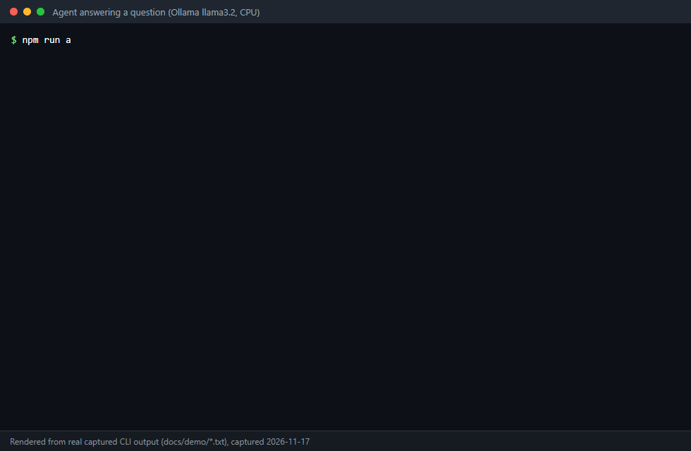
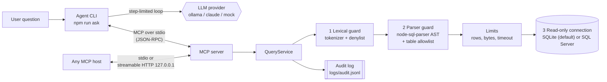

# sql-ai-agent-mcp

An MCP server that gives an LLM **read-only** SQL access to a sample business database, with layered guardrails, an audit log, and an agent CLI that answers business questions in plain English.

[](https://github.com/sahil-ambekarr/sql-ai-agent-mcp/actions/workflows/ci.yml)
[](LICENSE)




*The GIF is rendered from real captured CLI output ([docs/demo/](docs/demo/)) by `npm run demo:gif`; nothing in it was typed by hand. The first scene is a real llama3.2 run on a CPU-only laptop. I picked a question it also answered correctly in the eval; on the full set it gets 4 of 16 right (see Eval results). The other two scenes are writes blocked by the guard.*

## The problem it automates

People who are not SQL users keep asking the same kind of question: "who were our biggest customers last quarter?", "how many tickets are open?". Letting an LLM write SQL for them is useful, but giving a model a database connection is risky: it can be wrong, it can be talked into things by whoever writes the question, and it can be talked into things by text that is already stored in the rows it reads.

This project is a small, well-tested answer to that: a Model Context Protocol server that exposes `list_tables`, `describe_table` and `run_select`, where `run_select` only ever runs one plain SELECT, with limits, a timeout and an audit trail. Any MCP host can use it. The repo also includes my own agent client and an eval, so I can say how well a small local model actually does with it.

It is a portfolio project. The data is fictional and generated by a seeded script.

## Architecture



## Features

- **MCP server** built on the official MCP TypeScript SDK (v2 packages `@modelcontextprotocol/server`, `/client`, `/node`), over stdio and optionally streamable HTTP (127.0.0.1:4104, Host/Origin checked).
- **Three read-only tools**: `list_tables`; `describe_table` (columns, types, nullability, primary key, foreign keys, row count); `run_select` (one query, optional row limit).
- **Guardrails in layers** (table below): tokenizer-based checks, an AST check, a table allowlist, a read-only database connection, row/size/time limits.
- **Append-only JSONL audit log** of every tool call: timestamp, tool, query, decision, layer, reason, rows, duration.
- **Two backends behind one interface**: SQLite (default, zero setup) and SQL Server (`mssql`, `docker-compose.yml`, generated T-SQL seed with a least-privilege login). SQL Server is **not verified locally** (see below).
- **Agent CLI** (`npm run ask`) that connects as a real MCP client, primes the schema through the tools, loops with a step limit, and prints the answer plus every SQL statement it ran.
- **Provider abstraction**: `ollama` (default, llama3.2), `claude` (official Anthropic SDK), `mock` (scripted, used in tests and CI).
- **Eval**: 16 business questions with SQL-computed expected answers; reports accuracy, mean steps, mean latency and guardrail blocks.
- **Prompt-injection fixture**: support ticket 42 contains text telling the agent to `DROP TABLE customers`. A test scripts a model that obeys it; the guardrails block every attempt.

### Guardrails

| Layer | What it checks | Example it stops | Where |
|---|---|---|---|
| Input | String, non-empty, at most 8000 chars, no control characters | `SELECT 1\u0000; DROP ...` | `src/guard/validate.ts` |
| Lexical: comments | Any `--` or `/* */` comment (engines parse them differently) | `SELECT 1 /*! ; DROP TABLE x */` | `src/guard/lexer.ts`, `validate.ts` |
| Lexical: statements | `;` outside strings, except one trailing | `SELECT 1; DELETE FROM orders` | same |
| Lexical: first keyword | Must be `SELECT` or `WITH` | `PRAGMA writable_schema=1`, `VALUES (1)` | same |
| Lexical: denylist | INSERT, UPDATE, DELETE, MERGE, DROP, ALTER, CREATE, TRUNCATE, INTO, RETURNING, EXEC, PRAGMA, ATTACH, VACUUM, GRANT, WAITFOR, OPENROWSET, LOAD_EXTENSION, `xp_`/`sp_` procedures, variables and bind parameters ... (words in string literals are ignored) | `WITH x AS (DELETE ... RETURNING *) SELECT ...`, `SELECT * INTO #t ...` | same |
| Parser | node-sql-parser must return exactly one `select` with no INTO / FOR UPDATE / nested write node; fails closed if it cannot parse | anything the lexical layer missed that is not a plain SELECT | `validate.ts` |
| Table allowlist | Every table read must be an exposed business table (or a CTE name) | `SELECT * FROM sqlite_master` | `validate.ts` |
| Database | SQLite opened `readonly` + `query_only`; runner refuses statements SQLite reports as writing. SQL Server: `db_datareader` login with explicit DENY on writes and EXECUTE | a write that slipped past every check above | `src/db/sqlite-runner.ts`, `mssql/init/01-seed.sql` |
| Row limit | Default 100, caller may ask for less or more, hard max 500 (clamped, with a note) | `SELECT * FROM order_items` returns 100 rows, flagged truncated | `src/server/query-service.ts` |
| Result size | Stop adding rows once their JSON passes 64 KiB | wide `SELECT *` on tickets | `src/db/types.ts` |
| Timeout | 5 s; the SQLite runner process is killed and restarted | endless recursive CTE | `src/db/sqlite.ts` |
| Audit | Every allowed, blocked, failed and timed-out call is appended to `logs/audit.jsonl` | | `src/audit.ts` |

Full threat model, including prompt injection through stored rows and the known gaps: [docs/threat-model.md](docs/threat-model.md).

## Tech stack

TypeScript 6 run directly by Node 24 (type stripping, no build step needed to run), `@modelcontextprotocol/server` / `client` / `node` 2.x, `better-sqlite3`, `mssql`, `node-sql-parser`, `zod` 4, `@anthropic-ai/sdk`, Ollama HTTP API, Vitest, ESLint (typescript-eslint), Playwright + gifenc + pngjs (demo GIF only).

## Quick start

Requires Node 24 (or 22.18+). Ollama is only needed for real LLM answers.

**Windows (PowerShell)**

```powershell
git clone https://github.com/sahil-ambekarr/sql-ai-agent-mcp.git
cd sql-ai-agent-mcp
npm ci
Copy-Item .env.example .env
npm run seed                      # builds data/sample.db (about 11,400 rows)

# Try the tools directly, no LLM:
npm run tool -- list_tables
npm run tool -- run_select "SELECT country, COUNT(*) AS n FROM customers GROUP BY country"
npm run tool -- run_select "SELECT 1; DROP TABLE customers"     # blocked

# Ask a question (needs Ollama with llama3.2 pulled):
ollama pull llama3.2
npm run ask -- "Which 5 customers spent the most last quarter?"

# Same pipeline with the scripted mock provider (no LLM):
$env:LLM_PROVIDER="mock"; npm run ask -- "Which 5 customers spent the most last quarter?"
```

**macOS / Linux**

```bash
git clone https://github.com/sahil-ambekarr/sql-ai-agent-mcp.git
cd sql-ai-agent-mcp
npm ci
cp .env.example .env
npm run seed
npm run tool -- run_select "SELECT COUNT(*) AS n FROM orders"
npm run ask -- "Which 5 customers spent the most last quarter?"
LLM_PROVIDER=mock npm run ask -- "Which 5 customers spent the most last quarter?"
```

### Use it from any MCP host

Run `npm run seed` once, then add the server to your MCP client's config (the shape below is the common `mcpServers` format; use absolute paths):

```json
{
  "mcpServers": {
    "sql-readonly": {
      "command": "node",
      "args": ["/absolute/path/to/sql-ai-agent-mcp/src/server/stdio.ts"],
      "env": {
        "DB_BACKEND": "sqlite",
        "SQLITE_PATH": "/absolute/path/to/sql-ai-agent-mcp/data/sample.db",
        "AUDIT_LOG_PATH": "/absolute/path/to/sql-ai-agent-mcp/logs/audit.jsonl",
        "ROW_LIMIT_DEFAULT": "100",
        "QUERY_TIMEOUT_MS": "5000"
      }
    }
  }
}
```

If your host's Node is older than 22.18, run `npm run build` and point `args` at `dist/server/stdio.js` instead. For HTTP: `npm run server:http` serves `http://127.0.0.1:4104/mcp` (stateless streamable HTTP).

### SQL Server backend (not verified locally)

```bash
cp .env.example .env    # set MSSQL_SA_PASSWORD and MSSQL_PASSWORD (SQL Server password policy applies)
npm run seed:mssql-script   # regenerates mssql/init/01-seed.sql (already committed)
docker compose up -d        # SQL Server 2022 + a one-shot seed container
DB_BACKEND=mssql npm run tool -- list_tables
```

I built this repo on a machine without Docker, so **the SQL Server path has not been run against a live server.** What is tested: the TOP row-limit rewrite, the catalog queries (as SQL text), the T-SQL guard dialect, and the generated seed script (`tests/mssql-dialect.test.ts`).

## Configuration

| Variable | Default | Meaning |
|---|---|---|
| `DB_BACKEND` | `sqlite` | `sqlite` or `mssql` |
| `SQLITE_PATH` | `data/sample.db` | SQLite file (created by `npm run seed`) |
| `MSSQL_HOST` / `MSSQL_PORT` / `MSSQL_DATABASE` | `localhost` / `1433` / `SampleBusiness` | SQL Server connection |
| `MSSQL_USER` / `MSSQL_PASSWORD` | `agent_reader` / (empty) | Least-privilege login created by the seed script |
| `MSSQL_ENCRYPT` / `MSSQL_TRUST_SERVER_CERTIFICATE` | `true` / `true` | TLS options for the driver |
| `ROW_LIMIT_DEFAULT` / `ROW_LIMIT_MAX` | `100` / `500` | Rows returned when no limit is given / hard cap |
| `QUERY_TIMEOUT_MS` | `5000` | Per-query timeout |
| `RESULT_MAX_BYTES` | `65536` | Cap on the JSON size of returned rows |
| `MAX_QUERY_CHARS` | `8000` | Longest accepted query |
| `AUDIT_LOG_PATH` | `logs/audit.jsonl` | Append-only audit log |
| `HTTP_PORT` | `4104` | Port for `npm run server:http` (binds 127.0.0.1) |
| `LLM_PROVIDER` | `ollama` | `ollama`, `claude` or `mock` |
| `OLLAMA_BASE_URL` / `OLLAMA_MODEL` | `http://localhost:11434` / `llama3.2` | Ollama endpoint and model |
| `OLLAMA_MODE` | `json` | `json` (JSON-action protocol) or `tools` (native tool calling) |
| `ANTHROPIC_API_KEY` / `CLAUDE_MODEL` | (empty) / `claude-haiku-5-5` | Claude provider; only used when `LLM_PROVIDER=claude` |
| `LLM_TIMEOUT_MS` | `300000` | Timeout per model call (CPU inference is slow) |
| `AGENT_MAX_STEPS` | `6` | Model calls per question before the agent gives up |
| `AGENT_TODAY` | (real date) | Pins "today" so "last quarter" is reproducible |
| `LOG_LEVEL` | `info` | JSON logs on stderr |

**Providers.** `ollama` is the default and the only one I measured. `claude` uses the official Anthropic SDK with tool use; I had no API key, so it is **not verified against the live API** and is covered by tests with a stubbed HTTP layer. `mock` replays a fixed script (or the gold SQL, in the eval); CI uses it, so CI needs no model, key or GPU.

**Ollama mode.** I implemented both Ollama's native tool calling and a JSON-action protocol. The default is `json`: the model replies with one JSON object (`run_select`, `describe_table`, `list_tables` or `final_answer`), Ollama's `format` parameter constrains decoding to a JSON Schema, the reply is validated with zod, and an invalid reply is sent back with the error for up to two retries.

## Eval results

Measured 2026-11-17 on a CPU-only laptop (AMD Ryzen 5 5500U, integrated graphics unused, 16 GB RAM, Windows 11), with Ollama shared with two other jobs. Full write-up with every question and the failure analysis: [docs/eval-results.md](docs/eval-results.md). Raw JSON: [eval/results/ollama-llama3-2-json.json](eval/results/ollama-llama3-2-json.json).

| Provider | Questions | Correct | Mean steps | Mean latency / question | Step-limit stops | SQL errors | Guardrail blocks |
|---|---|---|---|---|---|---|---|
| `ollama` llama3.2 3B, JSON mode | 16 (full set) | **4 (25.0%)** | 4.56 / 6 | 67.9 s | 6 (+1 hit the 5-min cap) | 11 | 0 |
| `mock` (replays the gold SQL) | 16 | 16 | 2.00 | under 0.1 s | 0 | 0 | 0 |
| `claude` | not measured (no API key; not verified against the live API) | | | | | | |

**Method.** The eval drives the real pipeline: it spawns the MCP server, runs the agent with "today" pinned to 2026-11-17, temperature 0, at most 6 model steps and 5 minutes per question, and grades the free-text answer against the result of each question's gold SQL on the seeded database (numbers within a tolerance, all expected names present, or the right month). A run that stops without a final answer never counts. The mock row only proves the plumbing and grading work; it says nothing about a model.

**Reproduce.**

```bash
npm run seed
npm run eval -- --provider ollama --mode json --budget-min 40 --question-min 5
npm run eval -- --provider mock
```

**What went wrong, and limitations.** The 3B model's main failures were PostgreSQL/MySQL date functions in SQLite (`EXTRACT`, `DATEDIFF`), selecting a column without joining its table, resending the same failing query until the step limit, and drifting into revenue queries nobody asked for. It never attempted a write, so the guardrails were not exercised by the model in this run (they are exercised by the test suite, including the prompt-injection fixture). Sixteen questions and one run is a small sample; grading is lenient about extra text; latency includes queueing on a shared CPU. I regraded one question after finding a grader bug (details in the write-up). Native tool-calling mode was not measured.

## Project structure

```
src/
  config.ts               env parsing and validation (zod)
  audit.ts                append-only JSONL audit log
  logger.ts               JSON logs on stderr
  guard/lexer.ts          SQL tokenizer (strings, quoted identifiers, nested comments)
  guard/validate.ts       SELECT-only guard: input, lexical, parser, allowlist
  db/types.ts             Backend interface, row/size collector
  db/sqlite.ts            SQLite backend; runs queries in a killable child process
  db/sqlite-runner.ts     the child process (read-only connection)
  db/mssql.ts             SQL Server backend (not verified live)
  db/mssql-dialect.ts     TOP rewrite and catalog queries (unit tested)
  server/query-service.ts limits + guard + audit around each tool
  server/tools.ts         MCP tool registration
  server/stdio.ts|http.ts transports
  agent/mcp-client.ts     MCP client that spawns the server
  agent/loop.ts           agent loop and system prompt
  agent/providers/        ollama, claude, mock
  agent/cli.ts            npm run ask
  agent/tool-cli.ts       npm run tool (direct tool calls, no LLM)
  seed/                   deterministic data generator, SQLite and T-SQL seeding
  eval/gold.ts|run.ts     expected answers and the eval runner
eval/questions.json       16 questions with gold SQL
eval/results/             saved eval runs
mssql/init/01-seed.sql    generated T-SQL seed (sqlcmd variables, no secrets)
docs/                     threat-model.md, eval-results.md, demo/ transcripts, screenshots/demo.gif
tests/                    Vitest suites
scripts/                  seeding and demo capture/render
```

## Tests

```bash
npm run lint && npm run typecheck && npm test
```

Last local run (2026-11-17, Node 24.13, Windows 11): **142 tests in 8 files, all passing**, about 15 s.

| File | Tests | What it covers |
|---|---|---|
| `tests/guard.test.ts` | 81 | 54 queries that must be blocked plus a check that the blocked suite stays large (stacked statements, comment tricks, writes in CTEs, `SELECT INTO`, PRAGMA/ATTACH, EXEC/xp_cmdshell, system tables, bind variables, NUL bytes ...), 20 legitimate queries that must pass, 6 detail checks (fail-closed parsing, layer names) |
| `tests/query-service.test.ts` | 13 | row limit and clamping, result-size cap, timeout kill and recovery, read-only connection as the last layer, table-name injection in describe_table, append-only audit log |
| `tests/mcp-integration.test.ts` | 8 | spawns the real server over stdio and calls every tool as an MCP client, including a blocked write, a timeout and schema validation |
| `tests/mcp-http.test.ts` | 2 | streamable HTTP transport and the Host-header guard |
| `tests/agent.test.ts` | 9 | agent loop over real MCP with the mock provider: schema priming, step limit, time limit, and the ticket-42 prompt injection (every write the "obedient" model tries is blocked) |
| `tests/providers.test.ts` | 11 | Ollama JSON and tools modes, retries, abort; Claude provider with a stubbed HTTP layer |
| `tests/eval-grade.test.ts` | 4 | eval grading: number tolerance, names, months, and that a run without a final answer never counts |
| `tests/mssql-dialect.test.ts` | 14 | T-SQL TOP rewrite, catalog SQL, T-SQL guard dialect, generated seed script |

CI (`.github/workflows/ci.yml`) runs lint, typecheck, build, seed, the tests, and `npm run eval -- --provider mock`.

## Key decisions

- **MCP SDK v2 packages.** The older single `@modelcontextprotocol/sdk` package is split in the current official release line into `@modelcontextprotocol/server`, `/client` and `/node` (v2 implements the 2026-07-28 spec). I used those and read their bundled type definitions for the API.
- **Eval runner that survives interruptions.** CPU-only, shared Ollama is slow (one question took over 10 minutes in an earlier attempt), so `npm run eval` rewrites its results file after every question, reconnects the MCP client if a question throws, and takes `--budget-min` to stop starting new questions after a wall-clock budget.
- **Defence in depth over one clever check.** Each guard layer is simple and independently tested; any one of them stops the blocked suite.
- **Reject comments outright** rather than trying to strip them the way each engine would.
- **Fail closed on parse errors**, with a PostgreSQL-grammar fallback for SQLite because node-sql-parser's SQLite grammar misses some valid syntax (`OVER (ORDER BY ...)`, `FILTER`, `NULLS LAST`).
- **SQLite queries run in a child process** so the timeout can kill a runaway query; better-sqlite3 is synchronous and cannot be interrupted from JavaScript.
- **Row limit by reading, not rewriting, on SQLite**; TOP rewrite on the outer SELECT plus a streaming cap on SQL Server (wrapping in a subquery breaks ORDER BY in T-SQL).
- **Schema priming.** The agent fetches the schema through `list_tables`/`describe_table` once and puts a compact version in the system prompt. With a 3B model this saves several slow steps; the model can still call `describe_table` itself.
- **JSON-action protocol by default for llama3.2.** Ollama's `format` constrains decoding to a JSON Schema, and in the eval run none of the 73 model steps ended in an unparseable reply (0 provider errors). I have not measured native tool-calling mode against it, so this is a design choice, not a measured win.
- **Pinned "today"** (`AGENT_TODAY`, 2026-11-17 in the eval) so "last quarter" has one correct answer. The seeded data ends 2026-09-30.
- **Node runs the TypeScript directly** (`erasableSyntaxOnly`), so there is no build step for development; `npm run build` emits `dist/` for hosts that need JavaScript.

## Roadmap

- Act on the eval failures: SQLite date-function hints in the prompt, detect a repeated failing query in the loop, one complete worked example query.
- Measure native tool-calling mode and a larger local model against the same 16 questions.
- Run the SQL Server path against a real instance and add it to CI as a service container.
- Column-level masking for personal data (customer emails).
- A `sample_rows` tool and per-table descriptions to help small models.
- Per-user auth on the HTTP transport.
- A larger eval set with paraphrased questions.

## License

MIT, see [LICENSE](LICENSE). Copyright (c) 2026 Sahil Ambekar.
